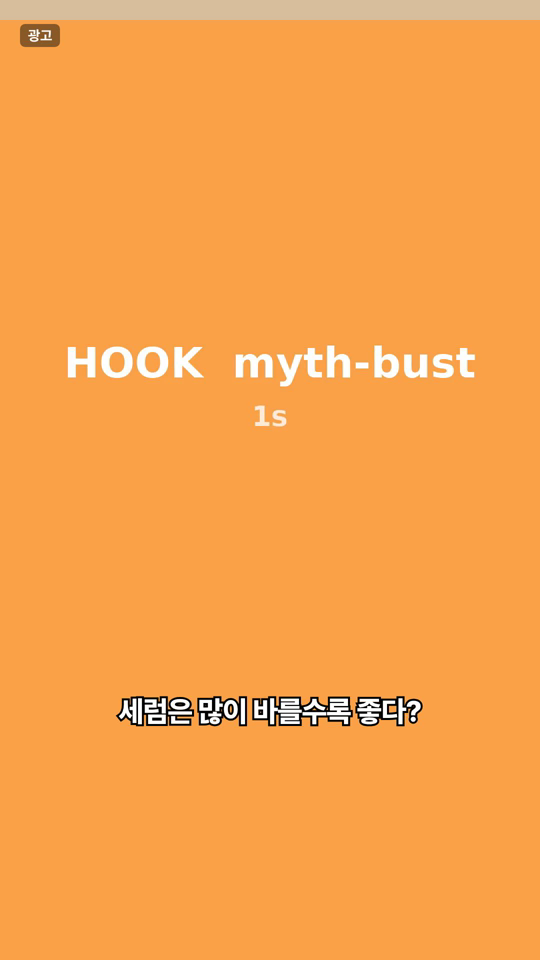
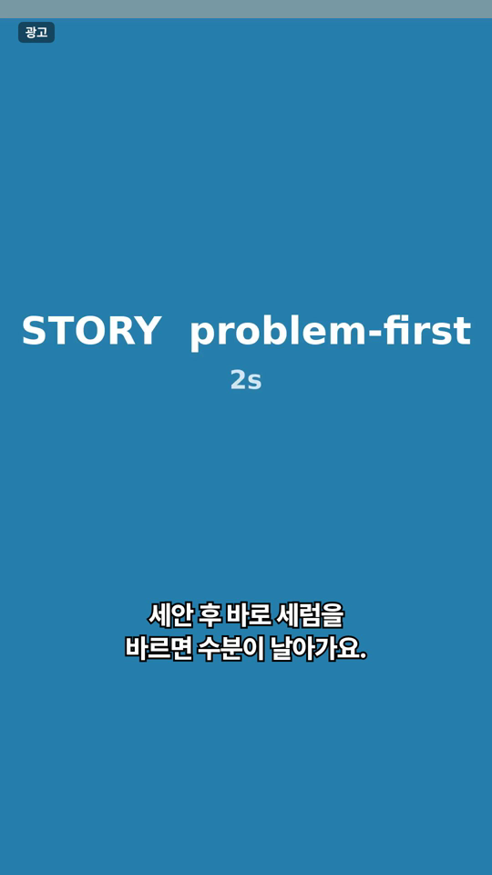
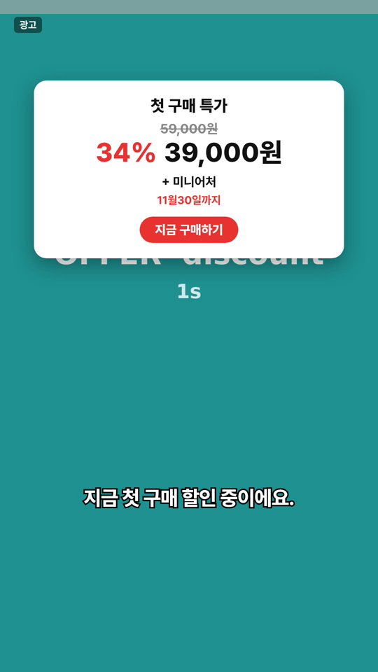
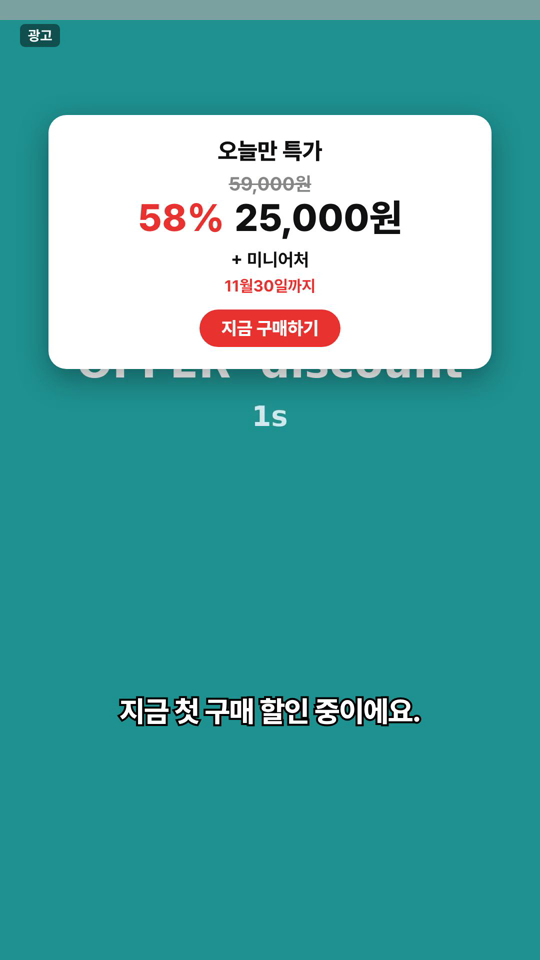
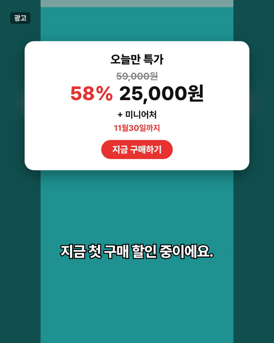

# ad-module-engine (ame)

광고 영상을 **후킹 · 브릿지 · 스토리 · 오퍼** 모듈로 나눠 관리하고, 규칙에 맞는 조합만 골라 **소재를 대량으로 렌더링**하는 엔진입니다.
업종과 브랜드에 묶이지 않고, 본부 단위 여러 사용자가 함께 쓰는 것을 전제로 설계했습니다.

> 현재 단계: **1단계 뼈대 (v0.1.0)** — 화면 없이 명령어(CLI)와 Claude 스킬로 끝까지 동작합니다.
> 개발 과정과 결정 이유는 [`docs/DEVLOG.md`](docs/DEVLOG.md)에 날짜별로 기록합니다.

---

## 무엇을 하나

```
모듈 영상 등록 ─▶ 배치(조합) 생성 ─▶ 검사 4단계 ─▶ 렌더 대기열 ─▶ MP4 (소재 코드 이름)
  규격 검사            후킹 테스트 등      호환·심의·          작업자가          + 조합 목록 CSV
  코드 부여            목적별 모드         길이·다양성          하나씩 처리
  규칙 팩 검사
```

- **모듈 등록**: 아무 이름의 영상을 넣으면 규격(해상도·프레임·길이)을 검사하고 `H014` 같은 모듈 코드를 붙입니다. 대사는 업종별 규칙 팩으로 검사해 차단 표현이 있으면 자동 반려합니다.
- **배치 모드**: 무작위로 섞지 않고 목적을 정해 조합합니다. 성과가 나왔을 때 무엇이 이겼는지 알 수 있게 하기 위해서입니다.
- **검사 4단계**: 주제가 안 맞는 조합, 심의 안 된 모듈, 목표 길이 밖, 한 유형으로 쏠린 조합은 자동으로 빠지고 이유가 남습니다.
- **템플릿 렌더링 (Remotion)**: 자막, 오퍼 카드(가격·할인율·마감일·사은품), 광고 표기, 비율 4종(9:16, 4:5, 1:1, 16:9)을 템플릿이 입힙니다. 가격만 바꿔 다시 렌더링하면 버전이 올라간 새 소재가 나옵니다.
- **소재 코드**: `DEMO_SERUM_H014-B003-S007-O002_916_30_v1` — 매체 광고 이름에 그대로 쓰면, 나중에 성과를 모듈 단위로 다시 쪼갤 수 있습니다.
- **계정 구조**: 관리자 계정(여러 개)은 팀 전체를 보고, 팀원 계정은 공통 + 본인 것만 봅니다.

## 데모 결과 (더미 클립, 2026-10-29)

| 9:16 후킹 | 9:16 스토리 | 9:16 오퍼 (처음) | 9:16 오퍼 (가격만 바꿔 재렌더링) |
| --- | --- | --- | --- |
|  |  |  |  |

4:5로 바꾸면 원본이 잘리지 않게 가운데 맞추고 양옆을 흐린 배경으로 채웁니다.



---

## 빠른 시작 (맥북)

필요한 것: **Node.js 20 이상**, **FFmpeg** (`brew install node ffmpeg`)

```bash
git clone https://github.com/gnqls96-bot/ad-module-engine.git
cd ad-module-engine
npm install
npm test            # 단위 테스트
npm run demo        # 더미 클립으로 전체 흐름 실행 → ./demo-workspace
```

`npm run demo`는 조직·계정 생성부터 렌더링, 가격 변경 재렌더링, CSV 출력까지 한 번에 돌립니다.
렌더링 없이 흐름만 보려면 `RENDER_LIMIT=0 npm run demo`.

어디서든 `ame` 명령으로 쓰려면:

```bash
npm link            # 이후 ame --help
```

처음 렌더링할 때 Remotion이 렌더용 Chrome을 자동으로 내려받습니다. 이미 설치된 Chrome 렌더러를 쓰려면 `AME_BROWSER=<경로>`.

---

## 핵심 개념

### 계정 구조

| | 관리자 계정 | 팀원 계정 |
| --- | --- | --- |
| 누가 | 파트장, 팀장, 본부장 | 팀원 각자 |
| 개수 | 여러 개. 관리자가 언제든 추가 발급 | 관리자가 발급 |
| 볼 수 있는 것 | 모든 팀원의 레퍼런스·모듈·배치·결과물 | 공통 + 본인 것 |
| 등록하면 | **공통** (모든 팀원에게 적용) | **개인** (본인만) |
| 생성에 적용되는 레퍼런스 | 공통 + 모든 팀원 | 공통 + 본인 |
| 관리 권한 | 계정 발급·정지, 브랜드·제품, 심의, 배치 승인, 팀원별 현황 | — |

- 팀원의 개인 레퍼런스·모듈이 잘 되면 관리자가 `promote`로 **공통으로 올릴** 수 있습니다 (원래 만든 사람 기록은 남음).
- 팀원이 만든 배치는 관리자 승인 후 렌더링됩니다 (브랜드 설정으로 끌 수 있음). 팀원이 가격을 바꾸면 다시 승인을 받습니다.
- 마지막 관리자 계정은 정지할 수 없습니다.
- 뼈대 단계에는 비밀번호 로그인이 없습니다. `ame login <이름>`은 "이 컴퓨터에서 누구로 작업하는지"만 정합니다. 실제 로그인은 3단계(웹 화면)에서 붙입니다.

### 배치 모드

| 모드 | 고정 | 바꾸는 것 | 쓰는 때 |
| --- | --- | --- | --- |
| `hook-test` (기본) | 브릿지·스토리·오퍼 | 후킹 N개 | 승자 본편에 새 후킹 붙이기 |
| `offer-test` | 후킹·스토리 | 오퍼 N개 | 프로모션 비교 |
| `story-test` | 후킹·오퍼 | 스토리 N개 | 새 촬영본 검증 |
| `full` | 없음 | 전부 | 초기 탐색 (상한 `--max`, 기본 200) |

### 검사 4단계

| 검사 | 실패 조건 |
| --- | --- |
| 호환 | `topic:` 태그를 가진 모듈끼리 주제가 하나도 안 겹침 / `excludeTags`에 걸림 |
| 심의 | 반려 모듈 포함, 또는 심의 대기 모듈 포함 (브랜드가 심의 필수일 때) |
| 길이 | 합친 길이가 목표 범위 밖 (15초: 10~18, 30초: 22~38, 60초: 45~70) |
| 다양성 | 바뀌는 모듈의 같은 유형(후킹 유형·화면 유형 등)이 배치의 50%를 넘음 (브랜드별 조정) |

### 소재 코드

```
DEMO_SERUM_H014-B003-S007-O002_916_30_v1
브랜드 제품  후킹 브릿지 스토리 오퍼  비율 길이 버전
```

- 브릿지 없음 = `B000`. 비율: `916` `45` `11` `169`.
- 같은 조합이라도 오퍼 데이터가 바뀌면 버전(`v2`)이 올라갑니다.
- `src/core/naming.ts`의 `parseMaterialCode()`로 다시 읽을 수 있습니다 (4단계 성과 연동에서 사용).

---

## 사용 예시

```bash
# 1) 조직과 첫 관리자
ame -w ~/ame-work init --org "마케팅본부" --admin "후빈"
cd ~/ame-work                                   # 이후 -w 생략 가능 (또는 AME_WORKSPACE)

# 2) 계정 발급
ame account create --name "팀원A" --role member
ame account create --name "팀장님" --role admin  # 관리자 계정 추가 발급

# 3) 브랜드·제품 (약칭은 영문 2~6자)
ame brand create --code DEMO --name "데모 코스메틱" --industry 화장품 --rulepack example
ame product create --brand DEMO --code SERUM --name "글로우 세럼" \
  --offer price=39000 originalPrice=59000 "headline=첫 구매 특가" deadline=11월30일 gift=미니어처 "cta=지금 구매하기"

# 4) 모듈: 폴더에 넣고 한 번에 등록 (brands/DEMO/SERUM/modules/{hook,bridge,story,offer}/)
ame module scan --brand DEMO --product SERUM
ame module review all approve --brand DEMO --product SERUM     # 관리자 심의
ame module list --brand DEMO --product SERUM

# 5) 후킹 테스트 배치 → 렌더링
ame batch create --brand DEMO --product SERUM --mode hook-test \
  --stories S001 --offers O001 --bridge B001 --length 30 --aspects 916,45
ame batch show <배치이름>
ame render <배치이름> --now           # 대기열 등록 + 바로 렌더링
# 또는: ame render <배치이름>  →  다른 터미널/컴퓨터에서 ame worker

# 6) 가격만 바꿔 다시 뽑기 (v2)
ame batch offer <배치이름> price=29000
ame render <배치이름> --now

# 7) 결과
ame jobs --batch <배치이름>
ame batch export <배치이름>           # 조합 목록 CSV (엑셀·구글 시트)
ame team                              # 팀원별 현황 (관리자)
```

### 모듈 대사·태그를 파일로 넣기

영상 옆에 같은 이름의 `.meta.json`을 두면 `module scan`이 함께 읽습니다.

```json
{
  "transcript": "바를수록 더 건조해지는 이유, 알고 계셨나요?",
  "tags": { "hookType": "paradox", "visualType": "selfcam" },
  "compatTags": ["topic:dryness"],
  "excludeTags": []
}
```

### 레퍼런스

```bash
ame reference add --title "건조함 역설 후킹 (경쟁사)" --source 스니핏 --run-days 45 --hook-type paradox
ame reference list
ame reference context --brand DEMO    # 이 계정에 적용되는 레퍼런스 + 많이 쓰인 패턴 (게재 일수 가중)
ame reference promote <ID>            # 팀원 개인 → 공통 (관리자)
```

`reference context`는 Claude 스킬이 후킹·대본을 쓸 때 읽는 형식입니다. 2단계 레퍼런스 분석기가 붙으면 태그와 대사를 영상에서 자동으로 채웁니다.

---

## Claude에게 말로 시키기 (스킬)

`skill/ad-module-engine/SKILL.md`가 "후킹 테스트 만들어줘", "가격 바꿔서 다시 뽑아줘" 같은 말을 `ame` 명령으로 바꾸는 방법을 Claude에게 알려줍니다.

- **Claude Code (맥북)**: `cp -r skill/ad-module-engine ~/.claude/skills/`
- **claude.ai**: `skill/ad-module-engine` 폴더를 zip으로 묶어 설정 → 기능 → 스킬에서 업로드

---

## 설정 (업종 지식은 코드가 아니라 설정 파일에)

| 파일 | 내용 | 덮어쓰기 |
| --- | --- | --- |
| `config/taxonomy.default.json` | 분류 체계: 후킹 유형, 스토리 구조, 오퍼 방식, 화면 유형, 타겟 | 작업 공간 `config/taxonomy.json` → 브랜드 `taxonomyOverride` |
| `config/rulepacks/*.json` | 업종별 규칙 팩: 차단 표현, 주의 표현, 필수 문구 | 작업 공간 `config/rulepacks/<id>.json` 추가 |
| `config/brandkit.default.json` | 브랜드 키트: 폰트, 자막 스타일, 오퍼 카드 색, 광고 표기 | `ame brand set <코드> --kit kit.json` |

- `example` 규칙 팩은 구조 확인용 예시입니다. 실제 업종 팩은 담당 브랜드가 정해지면 만듭니다.
- 분류 체계에 없는 태그 값도 등록은 됩니다 (새 유형 후보). `ame taxonomy --brand <코드>`로 현재 분류 확인.

## 작업 공간 폴더

```
<작업 공간>/
  .ame/db.json, session.json       데이터 (뼈대: JSON 파일, 이후 Supabase)
  config/                          조직 설정 덮어쓰기
  brands/<브랜드>/<제품>/
    modules/hook|bridge|story|offer/   모듈 영상 (H001_원래이름.mp4)
    renders/<배치>/                    결과 MP4 + 조합목록 CSV
  references/common|<계정ID>/       레퍼런스 파일
```

작업 공간을 구글 드라이브 동기화 폴더에 두면 영상 저장소가 드라이브가 됩니다. 엔진 코드는 그대로입니다.

## 렌더 작업자

- `ame worker`는 대기열이 빌 때까지 작업을 하나씩 처리합니다. 같은 작업 공간을 보는 작업자를 여러 개 띄우면 나눠서 처리합니다.
- 작업자가 중간에 꺼져 "진행 중"으로 남은 작업은, 같은 컴퓨터면 다음 실행 때 바로, 다른 컴퓨터면 30분 뒤 다시 대기열로 돌아갑니다.
- 환경 변수: `AME_CONCURRENCY` (동시 렌더 프레임 수), `AME_BROWSER` (Chrome 렌더러 경로).
- 원본과 출력 비율이 같으면 영상 한 겹만 그려서 빠르게, 다르면 흐린 배경 + 가운데 맞춤으로 렌더링합니다.

---

## 프로젝트 구조

```
bin/ame.mjs                    명령어 진입점
src/core/                      엔진 (화면·렌더링과 무관)
  types.ts                     데이터 구조 (조직 → 브랜드 → 제품 → 모듈·배치·렌더 작업)
  access.ts                    계정·공개 범위 규칙
  store.ts                     저장소 인터페이스 + JSON 구현 (파일 잠금)
  workspace.ts                 작업 공간 폴더·세션
  config.ts                    분류 체계·규칙 팩·브랜드 키트 읽기
  media.ts                     ffprobe, 모듈 규격 검사
  modules.ts                   모듈 등록·스캔·심의
  references.ts                레퍼런스, 생성용 컨텍스트
  combinator.ts                배치 모드, 검사 4단계
  naming.ts                    모듈·조합·소재 코드
  queue.ts                     렌더 대기열
  report.ts                    CSV, 팀원별 현황
src/render/
  remotion/                    Remotion 템플릿 (AdVideo, 자막, 오퍼 카드)
  renderer.ts                  번들, 로컬 미디어 서버, 렌더 1건
  worker.ts                    렌더 작업자
src/tools/dummy.ts             더미 클립 생성기
src/cli/                       명령어
config/                        기본 설정 파일
skill/ad-module-engine/        Claude 스킬
tests/                         단위 테스트 (vitest)
scripts/demo.sh                전체 흐름 데모
docs/DEVLOG.md                 개발 기록
```

## 로드맵

| 단계 | 내용 | 시점 |
| --- | --- | --- |
| **1. 뼈대** ✅ | 엔진, 템플릿, 대기열, CLI, Claude 스킬 | 2026-10-29 |
| 2. 레퍼런스 분석기 | 스니핏·메타 광고 라이브러리에서 저장한 광고를 받아쓰기 + 후킹/스토리/오퍼 구간 분석 + 분류 체계 확장 | 뼈대 직후 |
| 3. 팀용 화면 | 웹 화면, 로그인, Supabase(DB·저장소), 조합 미리보기·승인 | 이직 전후 |
| 4. 성과 시스템 | 소재 코드로 매체 성과 연동, 모듈별 성과·다음 배치 추천, 피로도 감지, 팀 대시보드 | 입사 후 |

## 주의

- **Remotion 라이선스**: 개인·소규모 팀은 무료지만, 회사 규모에 따라 유료 회사 라이선스가 필요할 수 있습니다. 회사에서 본부 단위로 도입하기 전에 [remotion.dev/license](https://www.remotion.dev/license)를 확인하세요.
- **폰트**: Pretendard (SIL Open Font License 1.1, `src/render/public/fonts/LICENSE-Pretendard-OFL.txt`).
- **데이터**: 회사 영상과 성과 데이터는 회사 저장소·계정 안의 작업 공간에만 둡니다. 이 저장소에는 코드와 더미 데이터만 있습니다.
- 이 엔진은 입사 전 개인 프로젝트로 개발했습니다 (커밋 기록 참고).
